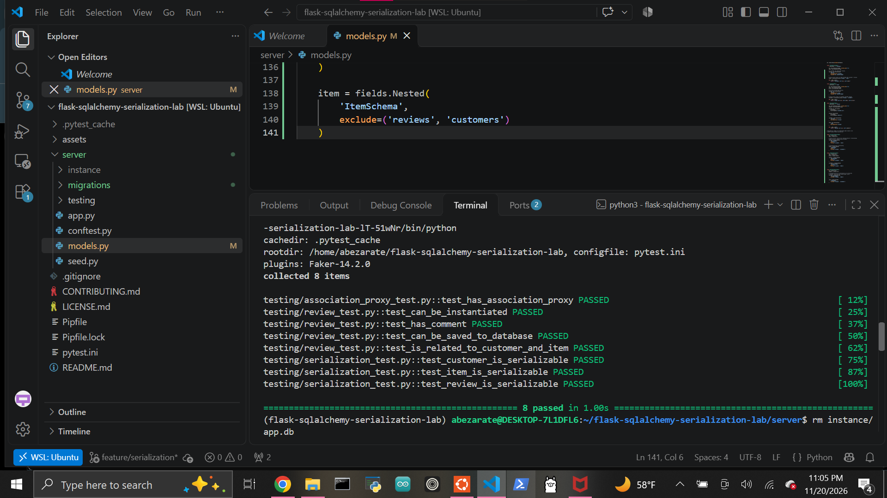

# Flask-SQLAlchemy Serialization Lab

This project demonstrates relationships, association proxies, database migrations, and object serialization using Flask-SQLAlchemy and Marshmallow.

The application models customers, items, and product reviews.

## Models

### Customer

- `id`
- `name`
- Has many Reviews
- Accesses reviewed Items through an association proxy

### Item

- `id`
- `name`
- `price`
- Has many Reviews
- Accesses Customers through reviews

### Review

- `id`
- `comment`
- `customer_id`
- `item_id`
- Belongs to a Customer
- Belongs to an Item

## Relationships

The central relationship is:

```text
Customer ──< Review >── Item
```

A Customer can write many Reviews, and an Item can receive many Reviews.

The `Review` model acts as the intermediary between Customers and Items.

## Association Proxy

Customers can access Items directly through their Reviews using SQLAlchemy's `association_proxy`.

For example:

```python
customer.items
```

provides the Items associated with that Customer's Reviews without manually iterating through each Review.

## Serialization

Marshmallow schemas serialize SQLAlchemy model instances into dictionary structures that can be converted to JSON.

The project includes:

- `CustomerSchema`
- `ItemSchema`
- `ReviewSchema`

Nested schemas represent related objects while excluding relationship fields that would otherwise cause circular serialization.

For example, a Review can contain its related Customer and Item without recursively serializing their Reviews again.

Foreign-key fields such as `customer_id` and `item_id` are not included in the serialized Review output. Instead, the related Customer and Item objects are nested directly.

## Database Migrations

Apply the existing migrations from the `server` directory:

```bash
flask db upgrade head
```

The migration history includes:

1. Initial Customer and Item tables
2. Review table with foreign-key relationships

## Seed the Database

From the `server` directory:

```bash
python seed.py
```

The seed data creates:

- 3 Customers
- 3 Items
- 5 Reviews

## Setup

Install dependencies and activate the virtual environment:

```bash
pipenv install
pipenv shell
```

Move into the server directory:

```bash
cd server
```

Configure Flask:

```bash
export FLASK_APP=app.py
export FLASK_RUN_PORT=5555
```

## Testing

Run the complete test suite:

```bash
pytest -v
```

The completed implementation passes all 8 tests covering:

- Review model behavior
- Customer and Item relationships
- Association proxies
- Marshmallow serialization
- Nested relationship serialization

## Test Results

